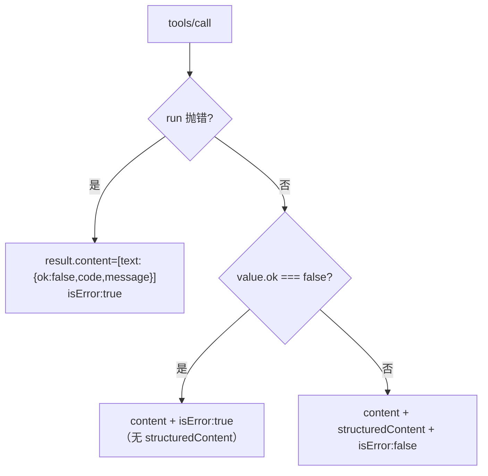

# MCP 兼容层（`mcp/server.mjs`）

> 把 AgentMemory 资料库的七个 `library_*` 工具以 MCP 方式暴露给 **DSH 之外**的客户端。
> **DSH 内部不要接这一层** —— 原生 `library_*` 工具就是正主，接进来只会多七个前缀重复的工具
> 与一份多余的后端缓存。本层的唯一用途是别的工具要读写这个库。
> 面向使用者/配置者的引导见 skill：[`agentmemory-library-mcp`](../../../.agents/skills/agentmemory-library-mcp/SKILL.md)
> 本文是**实现说明**，讲取舍与验证方法。

---

## 1. 它是什么

```
                    ┌─────────────────────────────────────────┐
  MCP client ──────▶│ mcp/server.mjs（stdio，一行一条 JSON-RPC）│
  (Claude Code,     │  initialize / tools/list / tools/call    │
   Codex, 另一个     └───────────────┬─────────────────────────┘
   DSH profile…)                     │ 复用，不复制
                                     ▼
                     lib/config.mjs  →  inspectConfig → effective
                     lib/backend.mjs →  BackendPool → LocalBackend / CloudBackend
                     lib/publish.mjs →  runPublish
```

**不重写任何业务逻辑**：检索、路径校验、原子写、精准替换、云端镜像全部沿用插件内已有的 `lib/`。MCP 层只负责协议封包。所以「DSH 原生工具」与「MCP 工具」在语义上必须一致 —— 这是本层的验收标准，不是设计目标。

## 2. 为什么手写传输（而不是用 MCP SDK 的 server 包）

DSH 的 `node_modules/@modelcontextprotocol` 下只有 `core` 与 `client`（v2.2.0），**没有 `server` 包**：

```bash
node --input-type=module -e "import('@modelcontextprotocol/server')"
# → ERR_MODULE_NOT_FOUND
```

而 stdio 传输的协议本身极简：**一行一条 JSON-RPC 2.0 消息**。用 `node:readline` 切帧 + `JSON.stringify` 输出即可，代价是 30 行，收益是：

- 零新增依赖（插件 `docs/DUAL-MODE.md` 的硬约束第 4 条）；
- 不用为了一个桥去动 profile 的依赖树；
- 协议行为可完全审计（读得完的 200 行 vs SDK 的几万行）。

代价：`initialize` 的能力协商只实现到最小集（`tools`），不支持 `resources/subscribe`、`tasks`、sampling、elicitation。需要这些就换官方 SDK，届时只替换 `handle()` 与分帧层，`TOOLS` 数组可原样保留。

## 3. 协议面

| 方法 | 行为 |
|---|---|
| `initialize` | 回声客户端请求的协议版本（支持 `2025-06-18` / `2025-03-26` / `2024-11-05`）；`capabilities: { tools: { listChanged: false } }` |
| `notifications/initialized` | 只记 stderr，不回复 |
| `ping` | `{}` |
| `tools/list` | 七个工具，`inputSchema` 与 `index.js` 的 `defineTool` 参数逐字对齐 |
| `tools/call` | 走 `TOOLS[].run()` |
| `resources/list`、`prompts/list` | 返回空数组（不声明能力，但客户端偶尔会问） |
| 未知方法 | `-32601` |

### 结果封装规则



三条要点：

1. **业务失败不升级成协议错误**。`PATH_ESCAPES_LIBRARY` 这类应当让模型看见并自行纠正，所以留在 `result` 里，只置 `isError:true`。
2. **`isError:true` 时不带 `structuredContent`** —— 遵守「声明了 `outputSchema` 就必须给 `structuredContent`」的对偶：本层没声明 `outputSchema`，出错时就别给结构化内容，避免客户端按 schema 校验失败。
3. **`library_publish` 的失败要看 `exitCode`**，不是 `ok`：退出码 2（服务异常/备份过期）不代表内容没落盘。

## 4. 实测记录（2026-11-15）

| 验证 | 命令 | 结果 |
|---|---|---|
| 纯管道喂三行 | `printf … \| node mcp/server.mjs` | 三行回包，`tools/list` 七项，`library_status` 返回 `mode=local` |
| 真实 MCP 客户端 SDK | `@modelcontextprotocol/client` + `client/stdio` 子路径 | `tools/call` 读文件成功（`totalLines:55`） |
| 通用客户端 spawn | `StdioClientTransport`（子路径 `@modelcontextprotocol/client/stdio`） | 七个工具正常列出、`library_status` 报出库根 |
| 路径逃逸 | `../../etc/passwd` / `/etc/passwd` / `..` | 分别 `PATH_ESCAPES_LIBRARY` / `ABSOLUTE_PATH_NOT_ALLOWED` / `PATH_ESCAPES_LIBRARY` |
| 写 + 替换 + 再读 | `library_write` → `library_replace` → `library_list` | `changed:true`；写后已清理冒烟文件 |
| 参数对齐 | 与 `index.js` 的 `register()` 参数表逐项比对 | 七组全部一致（含必填标记） |

### 一个容易误判的细节

`@modelcontextprotocol/client` 的 **stdio 传输在子路径**，不在包根：

```js
import { Client } from '@modelcontextprotocol/client'
import { StdioClientTransport } from '@modelcontextprotocol/client/stdio'   // ← 子路径，别从包根 import
```

包根导出的只有 `StreamableHTTPClientTransport` / `SSEClientTransport` / `InMemoryTransport`。写成 `import { StdioClientTransport } from '@modelcontextprotocol/client'` 会得到 `SyntaxError: does not provide an export named`。

## 5. 与 DSH 原生工具的关系

| | DSH 原生（`index.js`） | 本桥（`mcp/server.mjs`） |
|---|---|---|
| 给谁用 | DSH 会话 | **非 DSH** 的 MCP 客户端 |
| 工具名 | `library_search` | `library_search`（客户端按 server 名自己加前缀） |
| 配置来源 | profile config + 设置页（volatile 持有器） | 环境变量 |
| 后端实例 | DSH 进程内 `BackendPool` | 桥子进程内 `BackendPool` |
| 是否跑 DSH | 是 | **否**，只依赖仓库里的 `lib/` |

**不要**在 DSH 的 `cordis.patch.yml` 里加 `mcp-agentmemory-library` 条目。做了会得到：两套同名工具（原生 `library_search` 与 `mcp__agentmemory-library__library_search`）、一个常驻子进程、两份互不可见的后端缓存。DSH 里原生工具一直在，没有"缺一个 MCP 面"的问题。

两边同时读写同一个库是可以的（本地模式各自原子写，不会互相覆盖出半截文件），但**云端模式**下两个进程的镜像与 `.dsh-mirror.json` 是两份，TTL 内可能读到对方还没同步的旧快照 —— 调小 `AGENTMEMORY_CLOUD_REFRESH_TTL_MS`，或只让一边写。

## 6. 已知限制

1. 只实现 `tools` 能力；`resources` / `prompts` / `tasks` / sampling / elicitation 均未实现。
2. `library_publish` 仅本地模式（云端返回 `PUBLISH_CLOUD_UNSUPPORTED`）。
3. `command: node` 依赖 PATH；MCP 客户端会用裁剪环境启动子进程，**生产配置请写绝对路径**。
4. stdout 是协议信道，任何 `console.log` 都会破坏流。
5. 无状态：不保存会话级游标，每次 `library_list` / `library_search` 都重新扫库（与原生实现一致）。

## 7. 改这个文件时别破坏什么

- `apply()` 式的"永不 throw"在这里体现为 `handle()` 的 try/catch —— 每个 `tools/call` 都必须有回包。
- `TOOLS[].inputSchema` 与 `index.js` 的参数表是**同一份契约的两个副本**；改了插件参数，两边都要改，并用上文「参数对齐」的方法复验。
- 名字保持七个原样（不加前缀）：前缀由**客户端**按 server 名加，服务端自己再加一层就成了 `mcp__x__library_y` 之类的怪名。